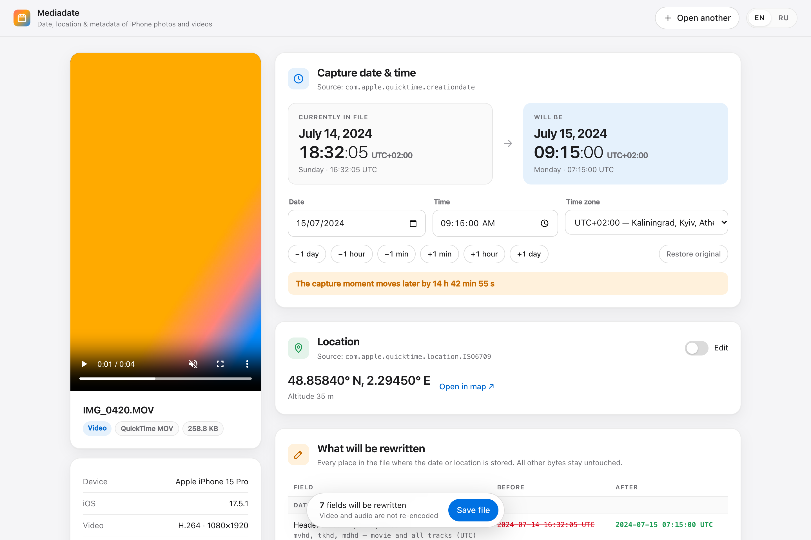
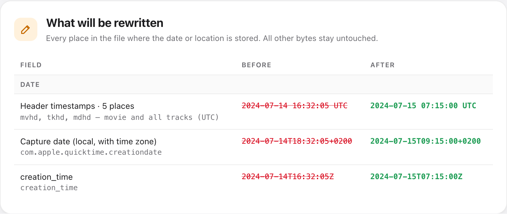
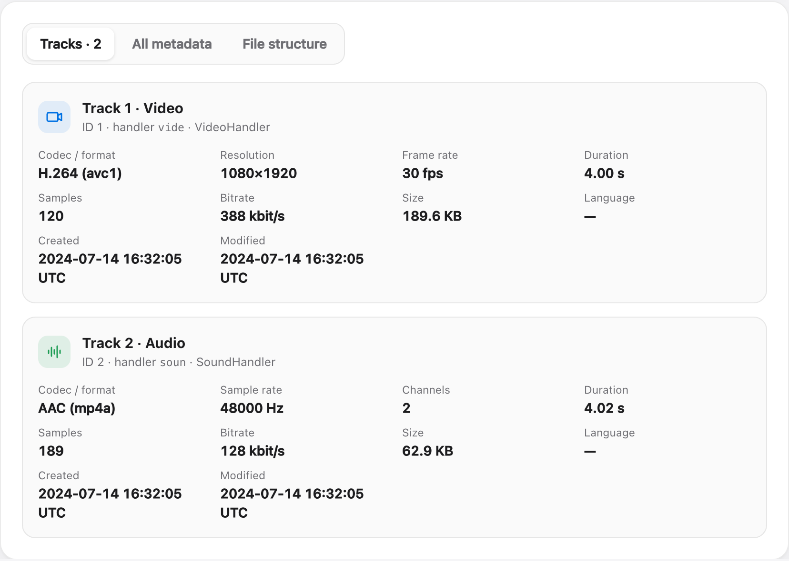
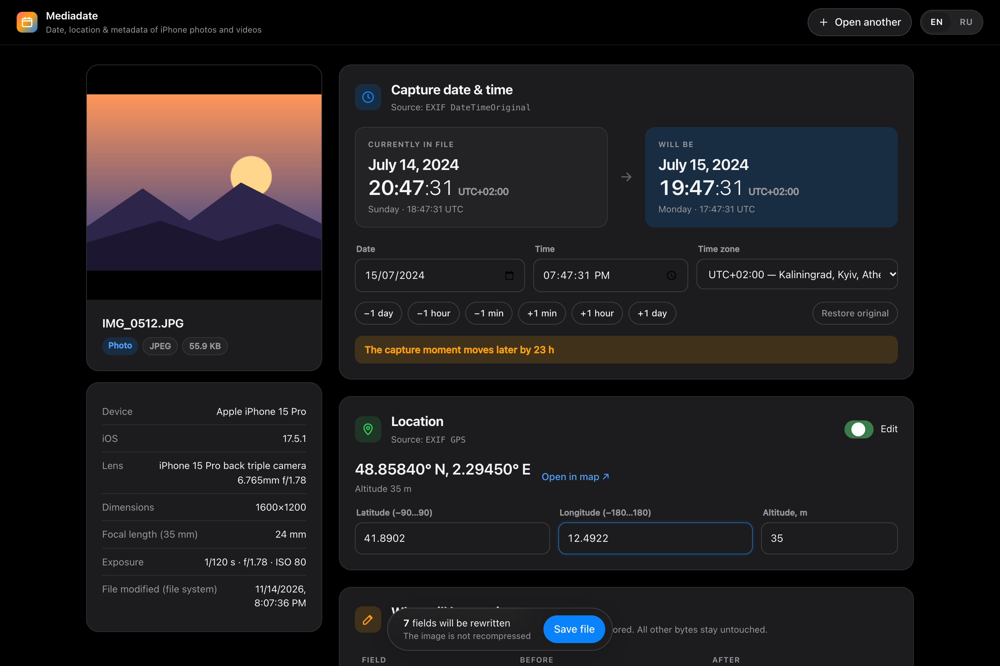
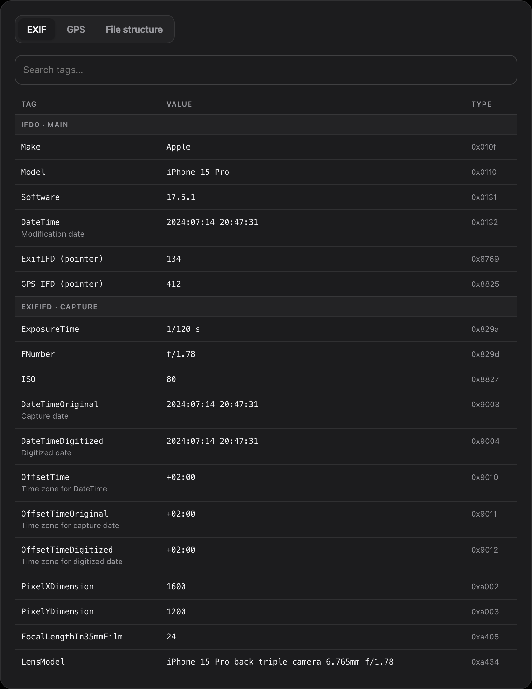

# Mediadate

**Fix the capture date and location of iPhone photos and videos — right in your browser, without re-encoding.**

[**Open the app →**](https://infiniteauravibes.github.io/iphone-media-date-fixer/)

---

Imported a video from an old phone, a messenger or a camera, and now it sits on the wrong day in the Photos timeline? Mediadate reads every place where an iPhone file stores its capture date and location, lets you pick the correct values, and writes them back **everywhere at once** — so every app sees the same date, whichever field it reads.

It is a single, self-contained HTML file. No install, no server, no uploads: **your file never leaves your computer.**

## Features

- **One edit, every field.** The date is rewritten in all the places it lives: QuickTime `mvhd` / `tkhd` / `mdhd` headers, `com.apple.quicktime.creationdate`, `udta ©day`, EXIF `DateTime*` + `OffsetTime*`, GPS date/time stamps and XMP.
- **Time zones done right.** See the local time and UTC side by side; change the time zone without moving the moment of capture, or shift the moment with quick ±1 min / hour / day buttons.
- **Location editing.** Change latitude, longitude and altitude (ISO 6709 in videos, EXIF GPS in photos). Paste `48.8584, 2.2945` straight into the latitude field.
- **Know exactly what changes.** A before / after table lists every field that will be rewritten. Nothing else in the file is touched.
- **Lossless.** Video and audio are never re-encoded and images are never recompressed. Photos are patched in place; videos only get a rebuilt `moov` box (chunk offsets are fixed up automatically).
- **A full metadata inspector.** Tracks, codecs, frame rate, bitrate, every QuickTime key, EXIF / GPS / Apple MakerNote / XMP tables with search, and an interactive box tree of the file structure.
- **Big files are fine.** Videos are read in slices — only the metadata box is loaded into memory.
- **Light & dark themes**, and an **English / Russian** interface switch.

## Screenshots

<table>
  <tr>
    <td width="50%"></td>
    <td width="50%"></td>
  </tr>
  <tr>
    <td align="center">Every field that will be rewritten, before → after</td>
    <td align="center">Track inspector: codecs, resolution, bitrate, timestamps</td>
  </tr>
  <tr>
    <td></td>
    <td></td>
  </tr>
  <tr>
    <td align="center">Photo date &amp; GPS editing (dark theme)</td>
    <td align="center">Searchable EXIF / GPS / MakerNote / XMP tables</td>
  </tr>
</table>

## Supported formats

| Type  | Formats              | What gets rewritten |
|-------|----------------------|---------------------|
| Video | MOV, MP4, M4V        | `mvhd`, `tkhd`, `mdhd` timestamps · `com.apple.quicktime.creationdate` (added if missing) · `com.apple.quicktime.location.ISO6709` · `udta ©day` / `©xyz` |
| Photo | HEIC / HEIF, JPEG    | EXIF `DateTime`, `DateTimeOriginal`, `DateTimeDigitized`, `OffsetTime*` · GPS date/time · GPS latitude / longitude / altitude · XMP dates (also in embedded images such as gain maps) |

## How to use

1. Open the [app](https://infiniteauravibes.github.io/iphone-media-date-fixer/) — or download [`index.html`](index.html) and open it locally, it works offline.
2. Drop a photo or video onto the page.
3. Set the correct date, time, time zone and (optionally) location.
4. Review the **What will be rewritten** table and click **Save file**.
5. AirDrop the saved file back to your iPhone. It appears in Photos on the corrected date — then delete the old copy.

## Privacy

Everything happens locally in the browser using the File API. There is no backend, no analytics and no network requests. The only external link is the optional **Open in map** button (OpenStreetMap), which opens only when you click it.

## Limitations

- A photo without a GPS block can't get coordinates added, because that would require rebuilding EXIF — location editing is disabled for such files.
- An XMP date is skipped if its new value would change the string length (EXIF and QuickTime fields are always handled).
- HEIC previews only render in browsers that support HEIC (Safari). Editing works everywhere.
- Video headers in 32-bit (version 0) format can store dates between 1904 and 2040.
- Saving uses the File System Access API where available (Chrome, Edge) and falls back to a regular download elsewhere.

## Development

There is no build step: all HTML, CSS and JavaScript live in [`index.html`](index.html).

- `Core` — a DOM-free module that parses ISO BMFF boxes (QuickTime / MP4 / HEIC), TIFF/EXIF and XMP, plans the changes and builds the output file.
- `I18N` — English (default) and Russian strings; the chosen language is remembered in `localStorage`.
- The UI script renders the workspace and wires up events.
